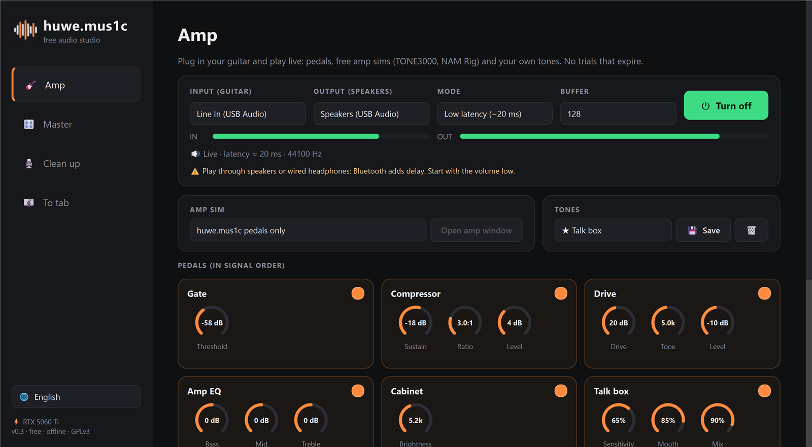
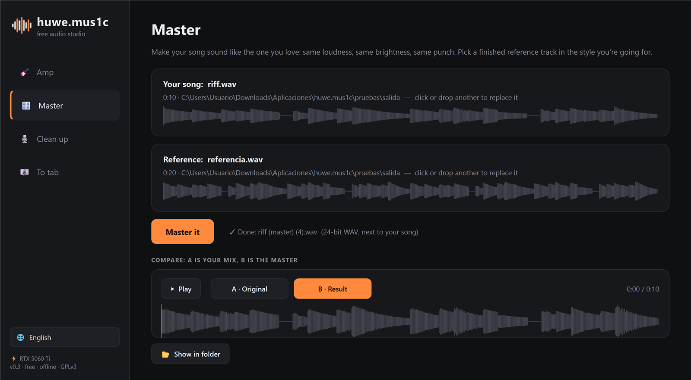
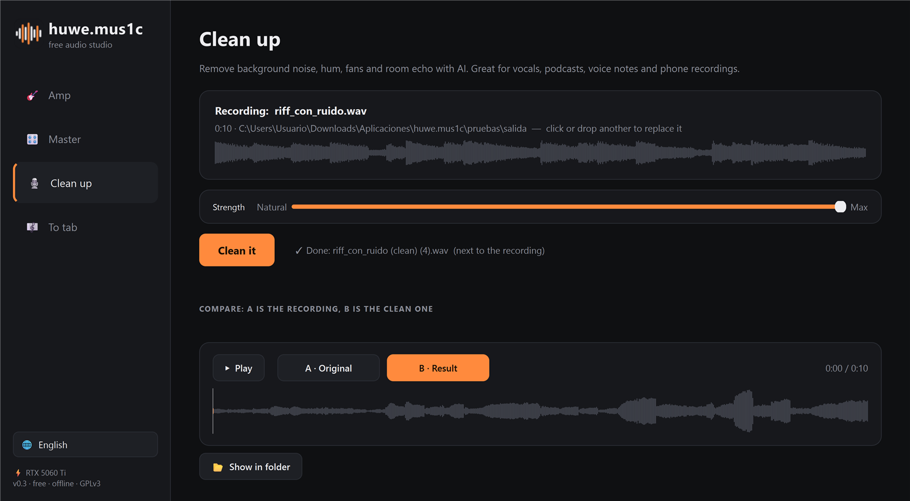
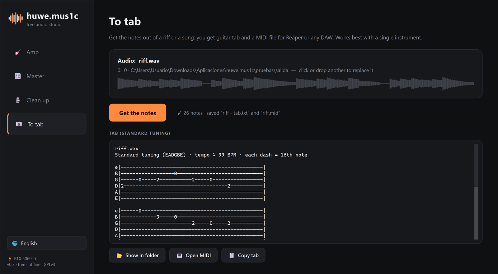

# huwe.mus1c

**A free, open-source, all-in-one audio studio for Windows.** Everything runs on your PC: there are no accounts, no subscriptions and no trials that expire.

| Tool | What it does | Like… |
|---|---|---|
| 🎸 **Amp** | Plug in your guitar and play live. It has 10 pedals (gate, compressor, drive, EQ, cabinet, tremolo, chorus, delay, reverb, master). It can also host free amp sims (**TONE3000**, **NAM Rig** or any VST3). You can save your own tones and record what you play. | Amp sim plugins |
| 🎛️ **Master** | Makes your song match a reference track's loudness, tone and punch. | iZotope Ozone, LANDR |
| 🎙️ **Clean up** | Uses AI to remove background noise, hum and room echo from vocals and recordings. | iZotope RX |
| 🎼 **To tab** | Turns a riff or song into **guitar tab** and **MIDI**. | Melodyne, transcription apps |

The interface is in **English** and **Spanish**; switch languages at the bottom left.



| Master | Clean up | To tab |
|---|---|---|
|  |  |  |

## Install

Download `huwe.mus1c-setup-x.y.exe` from **Releases** and run it.

The installer can also install the **TONE3000** amp plugin and open the official **NAM Rig** download page. Both are free.

> **"Windows protected your PC"?** The installer isn't code-signed, because signing costs money every year. Click **More info → Run anyway**. The full source code is in this repository, so you can check exactly what it does.

## Known limits (beta)

- **To tab** works best with one instrument playing one line. With a full band mix, expect a rough draft.
- The installer runs the AI on the **CPU**, to keep the download small, so long files take a while. Running from source with an NVIDIA GPU is faster.
- **Windows only** for now.

## Tips for the Amp

- Play through **speakers or wired headphones**. Bluetooth headphones add too much delay to play along.
- **Low latency** mode is about 20 ms. It takes over your sound card while the amp is on. Use **Compatible** mode (about 45 ms) if you need other sounds at the same time.
- Start with the volume low.
- To use TONE3000 tones, pick the plugin in **Amp sim** and press **Open amp window**. The tone library needs a free TONE3000 account.

## Run from source

```bash
uv venv --python 3.11 .venv
uv pip install --python .venv/Scripts/python.exe torch torchaudio --index-url https://download.pytorch.org/whl/cu128
uv pip install --python .venv/Scripts/python.exe --no-deps basic-pitch
uv pip install --python .venv/Scripts/python.exe -r requirements-build.txt
.venv/Scripts/python.exe huwe.mus1c.pyw
```

Use the `cpu` index instead of `cu128` if you don't have an NVIDIA GPU. The build steps for the installer are in `instalador/` (PyInstaller + Inno Setup).

## Credits and licenses

huwe.mus1c is **GPLv3** (see `LICENSE`). It stands on the shoulders of these projects:

- [Matchering](https://github.com/sergree/matchering): reference mastering (GPLv3)
- [DeepFilterNet](https://github.com/Rikorose/DeepFilterNet): AI noise removal (MIT / Apache-2.0)
- [Basic Pitch](https://github.com/spotify/basic-pitch) by Spotify: audio to MIDI (Apache-2.0)
- [Pedalboard](https://github.com/spotify/pedalboard) by Spotify: effects and VST3 hosting (GPLv3)
- [TONE3000 plugin](https://github.com/tone-3000/tone3000-plugin): NAM amp captures (MIT), bundled unmodified
- NAM Rig by Jordan Valeriote / Nouratone: free. It is **not** bundled; the installer links to its official page.
- PySide6 (LGPL), PyTorch, librosa, sounddevice / PortAudio, FFmpeg (via imageio-ffmpeg)

---

### Español

**huwe.mus1c** es un estudio de audio todo en uno, gratis y de código abierto:
- **Amplificador** de guitarra en directo, con pedales, TONE3000 y NAM Rig.
- **Masterizar** con una canción de referencia.
- **Limpiar voz** con IA.
- **Audio a tablatura y MIDI**.

Funciona sin internet y sin cuentas. Se instala con el `setup.exe` de *Releases*, y el idioma se cambia abajo a la izquierda.
